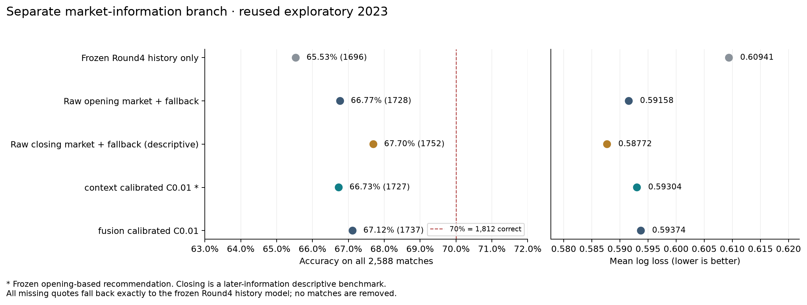

# 第五轮附加市场实验：更晚的赛前信息，不是纯历史算法增益

**通过市场信息升级门槛，冻结推荐为 `context_calibrated_C0.01`。** 在完整2,588场2023比赛上判对 **1727场（66.73%）**，距离70%仍需净增85场正确判断。

这个结果使用供应方称为开盘/赛前最后报价的市场信息。原任务只用赛事开始周及T−21历史；这里的信息通常更晚、来源也不同。**不能把加入市场后的改善归功于仅靠排名、状态和历史交手的模型达到同样效果。**2023已反复查看，本报告是探索性结果；2024–2025未打开。

## 同一全量分母，缺失精确回退

底模固定为第四轮 `add_age_spline_C0.01`，不根据本轮或主第五轮2023成绩换底模。训练阶段使用其2021/2022真实向前OOF概率，2023使用冻结预测。参数选择曾使用这些开发折，因而这些OOF不是一个全新独立测试集。

所有市场模型在无法匹配或双边赔率无效时，**逐行精确回退到该底模**。Opening与closing的缺失位置不同，两个全量分数因此包含不同的市场覆盖成分。

| 年份 | 完整目标 | 匹配 | opening有效 | opening回退 | closing有效 | closing回退 |
| --- | ---: | ---: | ---: | ---: | ---: | ---: |
| 2021 | 2388 | 2381 | 2374 | 14 | 0 | 2388 |
| 2022 | 2528 | 2495 | 2480 | 48 | 1859 | 669 |
| 2023 | 2588 | 2502 | 2487 | 101 | 2477 | 111 |

2021没有closing，故跨年可训练候选仅使用opening。Closing只作为独立描述基准，不参与门槛或最终推荐选择。不能仅保留有价格的样本，再把其分数称作完整2,588场成绩。

## 全量比较与70%目标

| 角色/模型 | 正确数 / 2588 | 准确率 | log loss | Brier |
| --- | ---: | ---: | ---: | ---: |
| 固定R4历史：`history_only` | 1696 | 65.53% | 0.609407 | 0.211493 |
| 原始开盘+缺失回退：`opening_market` | 1728 | 66.77% | 0.591583 | 0.204183 |
| 收盘独立描述+缺失回退：`closing_market_descriptive` | 1752 | 67.70% | 0.587718 | 0.202790 |
| 冻结推荐：`context_calibrated_C0.01` | 1727 | 66.73% | 0.593036 | 0.204699 |
| 最佳观察（不更改推荐）：`fusion_calibrated_C0.01` | 1737 | 67.12% | 0.593738 | 0.205052 |

全部开盘候选中的最高观察准确率为 `fusion_calibrated_C0.01`（67.12%，1737场）。含独立closing行的最高观察值为 `closing_market_descriptive`（67.70%，1752场）。**这些观察排序不覆盖冻结选择，也不能把closing的更晚报价条件混同于opening。**全量70%需要至少 **1812场正确**；达到目标本身不等于超过市场或达到SOTA。



## 市场信息贡献与额外算法贡献分开看

冻结推荐相对固定R4历史模型：准确率变化 **+1.20个百分点**，log-loss减少 **+0.016371**。这包含市场带来的额外信息。

相对**原始去水opening+相同缺失回退**：准确率变化 **-0.04个百分点**，log-loss减少 **-0.001453**；准确率变化的配对日期块95%区间为 **[-0.37, +0.28]个百分点**。相对开盘市场的配对区间包含0，不能确认存在额外预测增益。

区间按目标赛事开始日期分块，不校正多轮探索、参数选择及跨日期重复球员依赖。它是对已保存候选的条件描述，不是独立最终检验；Notebook保留全部模型相对历史与opening的区间。

## 冻结选择经过什么检验

共20个固定候选：历史底模、原始opening、固定概率/logit融合，以及三种对称logistic校准。阈值始终为0.5。2021H2在更早2021数据上拟合后选择 `fusion_calibrated_C0.01`；2022检查其准确率 **68.55%** 对历史 **67.13%**，提升 **+1.42个百分点**（要求至少0.50）；候选log loss **0.584323**，历史 **0.594658**，允许最多增加0.005。

之后用2021H2+2022时间外预测重选固定候选，并只用2021–2022拟合最终校准。冻结后才计算本轮2023成绩。2022本身也曾被前轮使用，所以这个门槛是明确的探索性决策规则，不是恢复了独立性。

## 来源、限制与复跑

数据：[Valuebetennis公开CSV](https://www.valuebetennis.com/en/donnees.htm)，[CC BY4.0](https://creativecommons.org/licenses/by/4.0/)。仅下载2021–2023。开盘与收盘字段没有逐条报价采集时间，只有供应方的赛前定义；无法独立证明每笔报价在规定预测时刻已公开。单一来源的历史导出不等于多家公司市场共识，也不构成投注收益结论。匹配只用身份、日期、赛事、场地及轮次，不用胜者或比分。

[来源与匹配审计](../../../docs/research/round5_market.md) · [独立市场协议](../../../docs/research/round5_market_protocol.md) · [执行Notebook](../../../round5_market.ipynb) · [HTML](../../../round5_market.html)

```sh
.venv/bin/python -m scripts.train_market_round5
.venv/bin/python -m scripts.report_market_round5
```

保留主T−21第五轮与本市场分支两个结论。最终测试应按各自冻结协议独立进行，继续保留原始opening、closing和历史模型对照。
