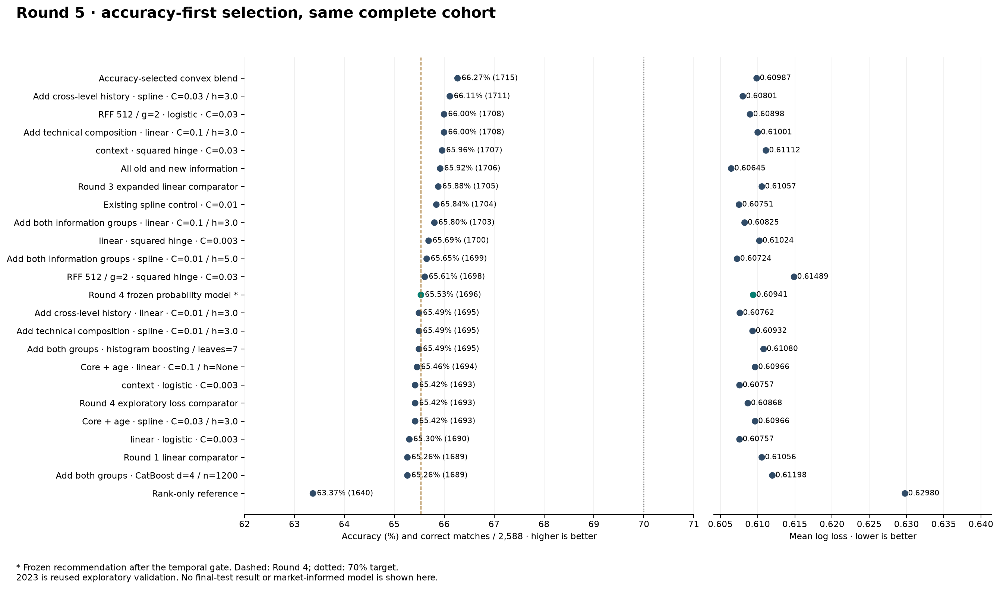

# 第五轮：向全量70%准确率推进

**结论：未通过升级门槛，保留第四轮概率推荐，冻结推荐为 `previous_probability_recommendation`。** 当前推荐 **1,696/2,588（65.53%）**，距离70%至少还需净增加 **116场**正确预测。 本轮最好的已观察2023准确率是 `accuracy_grid_blend` 的 **66.27%**（1,715场正确），距目标还差97场；这个排序不替代冻结选择。

主实验比较 **75个新配置和3个旧配置**，使用326项候选输入、33,833场训练目标和原样保留的2,588场2023目标。不同模型使用对应输入子集。目标70%需要至少 **1,812场**正确；没有挑高置信比赛、减少分母或放宽T−21历史规则。市场信息属于另一个信息条件，不混入本表。

## 为什么改变方法，以及如何选择

用户授权本轮改为**准确率优先**。跨级别历史补充Tour以外已发生的对局，技术组成细化已有发球统计；学习器比较有限年龄交互、随机傅里叶残差及logistic/squared-hinge目标。原概率推荐保持独立，不因新目标被改名或覆盖。公式、来源、反证和局限见[本轮协议](../../docs/research/round5_protocol.md)及[学习器说明](../../docs/research/round5_learning.md)。换损失不保证更准，校准也不能改变固定0.5阈值下的胜负决策。

2020–2021先选accuracy最高的候选；log loss必须不超过第四轮参照+0.005，同accuracy再比较log loss及固定名称。每种方法取一个合格配置，从至多四个候选枚举步长0.1的非负、和为1权重，包含单模型顶点。早期锁定的是：`r5_rff512_g2_squared_hinge_C0.03` × 0.5、`r5_rff512_g2_logistic_C0.03` × 0.3、`multilevel_linear_C0.1_halfNone` × 0.2。

在2022门槛年，参考accuracy为 **67.13%**，候选为 **67.33%**，变化 **+0.198个百分点**；需至少提高 **0.5个百分点**。候选log loss为 **0.58992**，参考为 **0.59466**，允许恶化不超过 **0.005**。两项条件必须同时满足；这不是显著性检验。

全部2020–2022折的候选重选结果为：`r5_rff512_g2_squared_hinge_C0.03` × 0.5、`r5_rff512_g2_logistic_C0.03` × 0.2、`both_spline_C0.01_half5.0` × 0.3。若升级失败，它只作为探索性对照；正式推荐仍为旧模型。全部选择和权重在本轮2023评分前冻结。**2022与2023此前已被查看，本轮仍是后续探索，2024–2025最终测试保持关闭。** 三个旧候选的纳入也继承此前探索历史，不能称为独立预注册。

## 同一批比赛的结果

| 模型 / 角色 | 正确场次 | 准确率 ↑ | log loss ↓ | 距70%差额 |
| --- | ---: | ---: | ---: | ---: |
| `rank_reference`（探索性对照） | 1,640 | 63.37% | 0.62980 | 172 |
| `previous_probability_recommendation`（本轮正式推荐） | 1,696 | 65.53% | 0.60941 | 116 |
| `previous_accuracy_comparator`（探索性对照） | 1,705 | 65.88% | 0.61057 | 107 |
| `previous_exploratory_best_loss`（探索性对照） | 1,693 | 65.42% | 0.60868 | 119 |
| `r5_rff512_g2_squared_hinge_C0.03`（探索性对照） | 1,698 | 65.61% | 0.61489 | 114 |
| `accuracy_grid_blend`（训练期候选，未获升级） | 1,715 | 66.27% | 0.60987 | 97 |
| `all_inputs_spline_C0.01`（2023最低观察loss，探索性） | 1,706 | 65.92% | 0.60645 | 106 |

训练期选出的本轮候选 `accuracy_grid_blend` 相对第四轮模型，纠正 **98场**旧错、同时新增 **79场**错误，净变化 **+19场**，accuracy变化 **+0.734个百分点**。赛事开始日期分块的配对区间为 **[-0.157, +1.638]个百分点**。**准确率区间跨过0，不能确认优于第四轮推荐。** 区间还没有涵盖跨日期重复球员依赖和全部模型搜索。

候选log-loss改善（旧减新）为 **-0.00046**，对应条件区间 **[-0.00543, +0.00463]**。负数表示概率预测变差；准确率提升不能替代概率质量报告。完整表另外保留Brier分数。

本轮保存比较中，最低2023 log loss来自 `all_inputs_spline_C0.01`：**0.60645**，准确率 **65.92%**（1,706场正确）。它是值得保留的概率预测对照，但这个已观察排序不改变本轮accuracy门槛或正式推荐。



## 哪些信息和目标有帮助

以下是严格固定学习器、正则和近期权重时，加入信息后的训练期变化；范围展示多个设置，不是置信区间：

- **加入跨级别历史 / 线性**：6组同设置配对，pooled CV准确率变化 **[+0.277, +0.701]个百分点**；其中6组提高。
- **加入技术组成 / 线性**：6组同设置配对，pooled CV准确率变化 **[-0.179, +0.277]个百分点**；其中3组提高。
- **同时加入两组 / 线性**：6组同设置配对，pooled CV准确率变化 **[+0.326, +0.701]个百分点**；其中6组提高。
- **加入跨级别历史 / 样条**：3组同设置配对，pooled CV准确率变化 **[+0.179, +0.343]个百分点**；其中3组提高。
- **加入技术组成 / 样条**：3组同设置配对，pooled CV准确率变化 **[+0.065, +0.196]个百分点**；其中3组提高。
- **同时加入两组 / 样条**：3组同设置配对，pooled CV准确率变化 **[+0.326, +0.392]个百分点**；其中3组提高。

相同表示和C下，squared hinge相对logistic的12项配对，pooled CV准确率变化范围为 **[-0.294, +0.506]个百分点**，6项提高。各项log-loss变化和逐年方向同时保留，不能用单个最优设置证明某损失天然更优。

Notebook保存全部 **45项信息添加/删除对照**和 **12项学习目标对照**。删除比较以“删除后减删除前”的accuracy变化及“删除前减删除后”的loss变化计，正数表示删除后更好。相关输入的增量是条件预测比较，不能解释成因果贡献。家族赢家还经过重新选择参数，不等同于严格同参数消融。所有候选CV都保留；未满足概率护栏的家族不会被强行列为正式候选。

## 复跑与交接

```bash
.venv/bin/python -m scripts.train_round5
.venv/bin/python -m scripts.report_round5
```

[执行notebook](../../round5.ipynb)、[HTML](../../round5.html)、[本轮协议](../../docs/research/round5_protocol.md)和独立的模型文件均保留此前实验。`search_registry.json`记录全部候选，`temporal_cv.csv`记录训练期比较，`frozen_selection.json`记录门槛与权重，`validation_predictions.csv`保存逐场概率，`frozen_models.joblib`用于冻结推理。

最终测试应比较本轮冻结推荐、第四轮概率推荐和既有强对照，使用相同信息时点和完整人群；在那之前，不将重复使用2023上的最高准确率写成已确认的70%泛化能力或SOTA。
